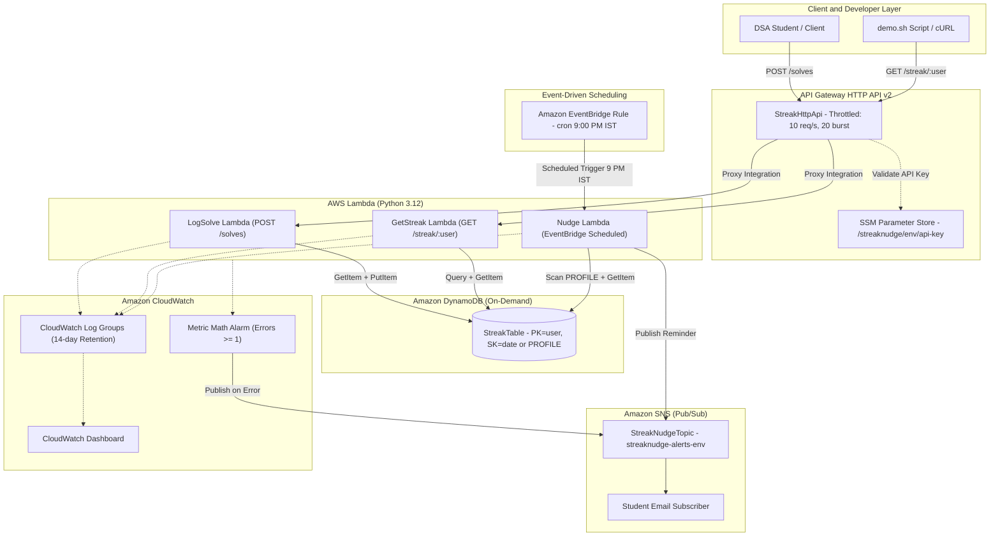

# StreakNudge 🚀

> **Serverless DSA/NeetCode Streak Tracker with Daily 9:00 PM IST Nudge**  
> **Course:** BIS505 Cloud Computing Mini-Project  
> **Tech Stack:** AWS SAM (Infrastructure as Code) | Python 3.12 Lambdas | DynamoDB Single-Table | EventBridge | Amazon SNS | CloudWatch | AWS Free Tier

---

## 1. Project Overview & Rubric Alignment

| Rubric Criteria | Implementation in StreakNudge | Cloud Concept Demonstrated |
| :--- | :--- | :--- |
| **Real-World Problem** | Developers struggle with consistency in daily Data Structures & Algorithms (DSA) preparation. StreakNudge tracks daily solves and automatically nudges the student at 9:00 PM IST if they have not yet logged a problem. | User retention, behavioral nudges, timezone-aware workflows. |
| **Multiple Cloud Services** | Combines **8 distinct AWS services**: API Gateway HTTP API v2, AWS Lambda, Amazon DynamoDB, Amazon EventBridge, Amazon SNS, AWS CloudWatch (Dashboards & Alarms), AWS Systems Manager (SSM) Parameter Store, and AWS IAM. | Distributed systems, microservices, Pub/Sub messaging, and event-driven automation. |
| **Deployment** | 100% defined as Infrastructure as Code (IaC) in [`template.yaml`](file:///home/jois/projects/streaknudge/template.yaml) using AWS Serverless Application Model (SAM). Deploys and tears down in single commands. | Infrastructure as Code (IaC), reproducible environments, continuous delivery. |
| **Scalability** | Fully serverless. Auto-scales from 0 to thousands of concurrent requests with $0 idle cost. Protected against abuse via API Gateway Stage Throttling (`10 req/s, 20 burst`). | Elasticity, concurrency controls, rate limiting, and DDoS mitigation. |
| **Security** | Zero-wildcard least-privilege IAM roles (`LogSolveRole`, `GetStreakRole`, `NudgeRole`), strict JSON schema validation, RFC 4xx error handling, and API key authentication decoupled via SSM Parameter Store. | Principle of Least Privilege (PoLP), Defense in Depth, credential decoupling. |
| **Monitoring** | CloudWatch Dashboard tracking Invocations, Errors, Duration, and DynamoDB RCU/WCU across all microservices, plus a Metric Math CloudWatch Alarm (`totalErrors >= 1`) routing directly to SNS email. | Centralized observability, Metric Math, Mean Time To Detect (MTTD), automated incident alerting. |
| **Free-Tier Cost** | Designed strictly within the AWS Free Tier. $0 fixed monthly cost when idle. | FinOps, Pay-as-you-go, serverless cost optimization. |

---

## 2. Architecture Diagram



---

## 3. DynamoDB Single-Table Design

To maximize efficiency and eliminate multi-table cost overhead, StreakNudge implements a **Single-Table Design** with overloaded partition and sort keys:

| Entity Type | Partition Key (`PK`) | Sort Key (`SK`) | Attributes Stored | Access Pattern |
| :--- | :--- | :--- | :--- | :--- |
| **User Profile** | `user` *(String)* | `"PROFILE"` | `email`, `timezone`, `last_active` | `GetItem(PK=user, SK='PROFILE')` to read user config; `Scan(FilterExpression=SK='PROFILE')` by Nudge Lambda. |
| **Daily Solve** | `user` *(String)* | `"YYYY-MM-DD"` *(IST Date)* | `problem`, `difficulty`, `streak_count`, `updated_at` | `GetItem(PK=user, SK=today)` and `GetItem(PK=user, SK=yesterday)` for $O(1)$ streak updates; `Query(PK=user, SK.begins_with('20'), ScanIndexForward=False, Limit=1)` for latest streak. |

### Why Single-Table?
1. **Free Tier Maximization**: AWS Free Tier grants 25 RCU and 25 WCU. Operating on a single table consolidates capacity without fragmenting quotas.
2. **Predictable Query Latency**: By querying only the primary key index with `Limit=1`, reads always take $O(1)$ constant time (1 RCU).
3. **Idempotence**: Since the sort key is the calendar date (`YYYY-MM-DD`), logging multiple solves on the same date updates the existing record without duplicating streaks.

---

## 4. Pure Streak Business Logic (`src/common/streak.py`)

Streak calculation is decoupled from cloud dependencies into pure, unit-tested functions:

* **Timezone Normalization**: Lambda system clocks run in UTC. StreakNudge converts timestamps to **Indian Standard Time (IST, UTC+05:30)** before extracting calendar dates.
* **First Solve**: Initializes `streak_count = 1`.
* **Consecutive Solve**: If user solved yesterday, `streak_count = yesterday_streak + 1`.
* **Same-Day Repeat**: If user solves multiple problems on the same calendar day, `streak_count` is preserved (no double-counting).
* **Gap (>1 Day Missed)**: Streak resets to `1` upon solving.
* **Active Status**: Streak is active if the last solve was **today** or **yesterday**; otherwise it is evaluated as `0` (broken).

---

## 5. Free-Tier Cost Analysis

StreakNudge runs at **$0.00 / month** under typical usage:

| AWS Service | Free Tier Monthly Allowance | StreakNudge Monthly Consumption (Est.) | Monthly Cost |
| :--- | :--- | :--- | :--- |
| **AWS Lambda** | 1,000,000 free requests & 3.2M sec compute | ~3,500 requests & 700 sec compute (128 MB) | **$0.00** |
| **Amazon DynamoDB** | 25 GB storage, 25 WCU, 25 RCU | < 1 MB storage, ~300 requests | **$0.00** |
| **API Gateway HTTP API**| 1,000,000 free calls (first 12 mos) | ~3,000 calls | **$0.00** |
| **Amazon EventBridge** | 1,000,000 free events/month | 31 scheduled cron events | **$0.00** |
| **Amazon SNS** | 1,000 free email notifications, 1M publishes | ~30 emails, 31 publishes | **$0.00** |
| **CloudWatch Logs** | 5 GB ingestion & 5 GB archive | < 15 MB with 14-day retention | **$0.00** |
| **CloudWatch Dashboards**| 3 free dashboards with up to 50 metrics | 1 dashboard with 4 widgets | **$0.00** |
| **CloudWatch Alarms** | 10 free metric alarms | 1 Metric Math alarm | **$0.00** |
| **SSM Parameter Store** | Standard parameters free forever | 1 standard parameter | **$0.00** |
| **Total** | | | **$0.00 / month** |

---

## 6. Directory Structure

```text
streaknudge/
├── template.yaml                  # AWS SAM infrastructure definition
├── frontend/                      # Gamified Web & Mobile Dashboard
│   ├── index.html                 # Entry point (auto-redirects to Home)
│   ├── api.js                     # Client SDK & Backend Settings modal
│   ├── streaknudge_home/          # Main dashboard (real streak, live countdown)
│   ├── streaknudge_log_a_solve/   # Form connected to POST /solves
│   ├── streaknudge_history/       # Solves calendar & history archive
│   └── streaknudge_mobile_*/      # Mobile-optimized companion screens
├── src/
│   ├── common/
│   │   ├── __init__.py
│   │   └── streak.py              # Pure IST streak logic (zero cloud dependencies)
│   ├── log_solve/
│   │   ├── __init__.py
│   │   └── app.py                 # POST /solves Lambda handler (CORS enabled)
│   ├── get_streak/
│   │   ├── __init__.py
│   │   └── app.py                 # GET /streak/{user} Lambda handler (CORS enabled)
│   └── nudge/
│       ├── __init__.py
│       └── app.py                 # Scheduled 9 PM IST Nudge Lambda handler
├── tests/
│   ├── conftest.py                # Mocked AWS credentials and region
│   ├── test_streak.py             # 11 unit tests for pure domain logic
│   ├── test_dynamodb_schema.py    # 4 integration tests for Single-Table design
│   ├── test_log_solve.py          # 8 tests for POST /solves & validation
│   ├── test_get_streak.py         # 7 tests for GET /streak/{user}
│   ├── test_nudge.py              # 4 tests for EventBridge & SNS notification
│   ├── test_cloudwatch_config.py  # 3 tests validating Dashboard & Error Alarm
│   ├── test_iam_audit.py          # 6 tests auditing PoLP and zero wildcards
│   └── test_frontend_integration.py # 2 tests verifying full-stack dev server
├── scripts/
│   ├── demo.sh                    # Colored cURL test script for live verification
│   └── dev_server.py              # Full-stack local server (UI + in-memory DynamoDB)
└── README.md                      # Complete documentation & report guide
```

---

## 7. Setup, Local Testing & Full-Stack Server

### Run Local Full-Stack Development Server (Zero Cloud Setup Needed)

You can run both the frontend dashboard and local serverless backend with an in-memory DynamoDB database in a single command:

```bash
# 1. Activate your virtual environment
source .venv/bin/activate

# 2. Start the local server
python3 scripts/dev_server.py 3000
```

Open your browser to:
* **Dashboard**: `http://localhost:3000/frontend/streaknudge_home/code.html`
* **Log Solve**: `http://localhost:3000/frontend/streaknudge_log_a_solve/code.html`
* **History**: `http://localhost:3000/frontend/streaknudge_history/code.html`

> [!TIP]
> The bottom-right **"Backend Config"** floating button in the UI lets you toggle between `http://localhost:3000` and your live deployed AWS API Gateway endpoint at any time with a single click!

### Run Unit & Integration Tests (100% Mocked with Moto)

```bash
# Execute all 45 automated tests
pytest tests/ -v
```

All 45 tests pass without connecting to real AWS infrastructure:
* 11 streak calculation logic tests
* 4 DynamoDB single-table schema tests
* 8 `LogSolve` API tests
* 7 `GetStreak` API tests
* 4 `Nudge` scheduling & SNS tests
* 3 CloudWatch Dashboard & Metric Math Alarm tests
* 6 IAM least-privilege audit tests
* 2 full-stack dev server and static frontend integration tests

---

## 8. Deployment Guide

### Deploy via AWS SAM CLI

```bash
# 1. Build the serverless application
sam build

# 2. Deploy to AWS interactively (first deployment)
sam deploy --guided

# Suggested Prompts:
# - Stack Name: streaknudge
# - AWS Region: ap-south-1 (Mumbai) or us-east-1
# - Parameter Environment [dev]: dev
# - Parameter NotificationEmail: your-email@domain.com
# - Parameter ApiKeyParam: streaknudge-secret-key-12345
# - Confirm changes before deploy [y/N]: y
# - Allow SAM CLI IAM role creation [Y/n]: Y
# - Save arguments to configuration file (samconfig.toml) [Y/n]: Y

# 3. Confirm SNS Email Subscription
# AWS will send a confirmation email to the address provided in NotificationEmail.
# Click "Confirm subscription" in that email to begin receiving 9 PM nudges!
```

---

## 9. Verification & Live Demo Script

Use the provided [`scripts/demo.sh`](file:///home/jois/projects/streaknudge/scripts/demo.sh) script to test all routes:

```bash
# Make script executable
chmod +x scripts/demo.sh

# Run against deployed endpoint
./scripts/demo.sh https://<api-id>.execute-api.ap-south-1.amazonaws.com/dev streaknudge-secret-key-12345
```

The script automatically executes and validates:
1. **Authentication Check**: Missing `x-api-key` header $\rightarrow$ Returns `401 Unauthorized`.
2. **Schema Validation**: Invalid problem difficulty $\rightarrow$ Returns `400 Bad Request`.
3. **First Solve**: Logs solve for `student_demo` $\rightarrow$ Returns `201 Created` with `streak_count: 1`.
4. **Idempotency Check**: Logs another solve on the same day $\rightarrow$ Returns `201 Created` with `streak_count: 1` (does not increment twice).
5. **Get Streak**: Retrieves active streak status $\rightarrow$ Returns `200 OK` with status `ACTIVE_TODAY`.
6. **Not Found Check**: Queries nonexistent user $\rightarrow$ Returns `404 Not Found`.

---

## 10. Clean Teardown

To avoid orphaned cloud resources or unexpected charges after project evaluation, delete the CloudFormation stack:

```bash
sam delete --stack-name streaknudge
```

Type `y` when prompted to confirm deletion. CloudFormation automatically deletes:
* API Gateway HTTP API
* All 3 Lambda functions and dedicated IAM roles
* DynamoDB Single-Table
* SNS Topic and Email Subscription
* CloudWatch Dashboard, Alarm, and Log Groups
* SSM Parameter Store entry
